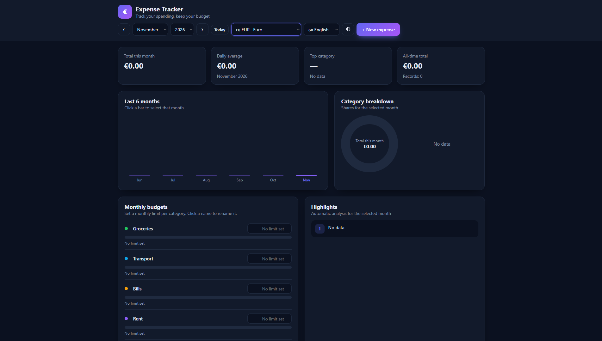

# Expense Tracker

A fast, private, single-file expense tracker with budgets, charts and automatic insights. It supports **10 languages** and **9 currencies**, and it runs entirely in your browser. There is no server, no account and no tracking.

[](LICENSE)


**[Live demo](https://codrex0.github.io/expense-tracker/)**



## Features

- **Expense management:** add, edit and delete expenses with a date, amount, category and optional note.
- **Monthly budgets:** set a limit per category. A progress bar turns amber at 80% and red when the limit is exceeded. Category names can be renamed.
- **Charts:** a six-month trend chart (click a bar to jump to that month) and a category breakdown donut.
- **Automatic insights:** largest expense, top category, average per entry, projected month-end total and budget warnings.
- **Search, filter and sort:** search descriptions and notes, filter by category, switch between the selected month and all records, and sort by date or amount.
- **10 languages:** Türkçe, English, Deutsch, العربية (full right-to-left layout), Русский, Français, 中文, हिन्दी, 한국어 and Español. Month names, numbers and dates follow the selected language.
- **9 currencies:** TRY, USD, EUR, GBP, SAR, RUB, CNY, INR and KRW, formatted with the browser's `Intl` API.
- **Light and dark themes:** the first visit follows your system preference.
- **Data portability:** CSV export and JSON backup and restore.
- **Keyboard shortcut:** press `N` to add a new expense.
- **Responsive:** works on phones, tablets and desktops.

## Privacy

All data stays in your browser's `localStorage`. Nothing is sent anywhere, and there are no analytics, cookies or external requests. The app loads no external fonts, scripts or libraries.

Clearing your browser data also deletes your expenses, so **download a backup regularly**.

## Getting started

### Use it online

Open the [live demo](https://codrex0.github.io/expense-tracker/).

### Run it locally

No build step is needed.

```bash
git clone https://github.com/codrex0/expense-tracker.git
cd expense-tracker
```

Then open `index.html` in your browser. Or serve it locally:

```bash
python3 -m http.server 8000
# open http://localhost:8000
```

### Deploy your own copy

1. Fork this repository.
2. Go to **Settings → Pages**.
3. Choose **Deploy from a branch**, then select `main` and `/ (root)`.
4. Your site will be live at `https://codrex0.github.io/expense-tracker/`.

## Usage

| Action | How |
| --- | --- |
| Add an expense | Click **+ New expense** or press `N` |
| Edit or delete | Use the buttons at the end of each row |
| Change month | Use the month and year selectors, the arrows, or click a bar in the trend chart |
| Set a budget | Enter a limit next to a category in **Monthly budgets** |
| Rename a category | Click its name in **Monthly budgets** and type a new one |
| Change language or currency | Use the selectors in the top bar |
| Export | **Download CSV** exports the current view. **Download backup (JSON)** exports everything |
| Restore | **Restore from backup** replaces the current data with the backup file |

## Data and security

- Imported backups and stored data are validated. Invalid dates, amounts and unknown categories are dropped, and duplicate IDs are fixed.
- All user-provided text is HTML-escaped before it is rendered.
- CSV cells that start with `=`, `+`, `-` or `@` are prefixed with `'`, so spreadsheet apps do not run them as formulas.
- CSV files use a semicolon delimiter and a UTF-8 BOM so they open correctly in Excel.

### Storage keys

| Key | Content |
| --- | --- |
| `gider-takip-v2` | Expenses |
| `gider-takip-budgets-v2` | Budget limits |
| `gider-takip-budget-names-v2` | Custom category names |
| `gider-takip-lang` | Selected language |
| `gider-takip-currency` | Selected currency |
| `gider-takip-theme` | Selected theme |

The `gider-takip-` prefix (Turkish for "expense tracker") is kept so that existing users' data stays compatible.

## Known limitations

- **Currency changes do not convert amounts.** Switching currency only changes how existing amounts are displayed. There is no exchange-rate logic.
- **Data lives in one browser.** There is no sync between devices. Use the JSON backup to move data.
- **The date field in the "add expense" dialog is the browser's native date input.** Its calendar language depends on your browser or operating system settings.
- **Category names are shown in the selected language.** Your own names (set under Monthly budgets) are shown as typed and are not translated.

## Browser support

Any current version of Chrome, Edge, Firefox or Safari. The app uses the `<dialog>` element, CSS logical properties and the `Intl` API.

## Project structure

```
expense-tracker/
├── index.html      # The entire app: HTML, CSS and JavaScript
├── README.md
├── LICENSE
└── screenshot.png
```

## Contributing

Contributions are welcome, especially new translations.

### Adding a language

All translations are in `index.html`:

1. Add the language to the `LANGS` array: `[code, flag, native name, locale]`.
2. Add its category names to the `CLR` object, in the same order as the other languages.
3. Add its UI strings to the `T` object. Strings are separated by `|` and **must follow the exact order of the `KEYS` list**. Keep the `{p}`, `{d}`, `{a}` and `{c}` placeholders unchanged.
4. For right-to-left languages, also update the `dir` logic in `applyStatic()`.
5. Open the app and check every section, including dialogs and error messages.

### Guidelines

- Keep the project dependency-free and in a single file.
- Test in both themes and at phone width.
- Open an issue before starting large changes.

## Roadmap

- [ ] Recurring expenses
- [ ] Import from CSV
- [ ] Optional exchange-rate conversion
- [ ] Installable PWA with offline support
- [ ] Localized date picker in the expense dialog

## Acknowledgements

This project was developed with the help of an AI assistant. All code is open for review and contributions.

## License

Released under the [MIT License](LICENSE). Copyright (c) 2026 codrex0.